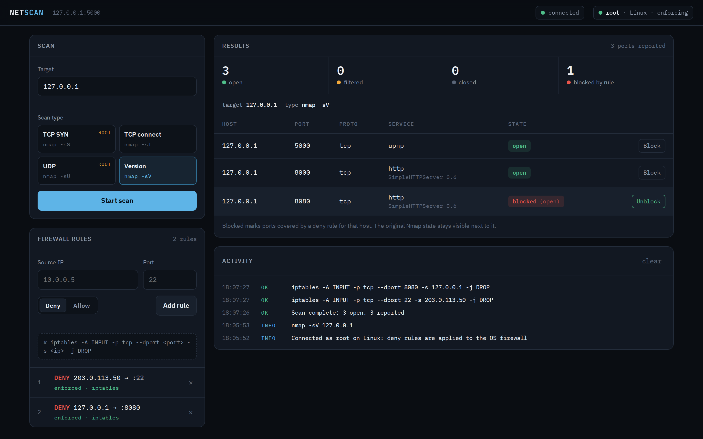
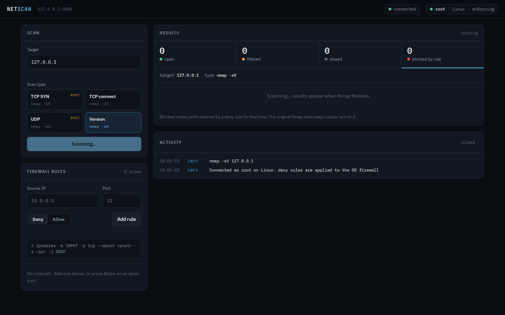
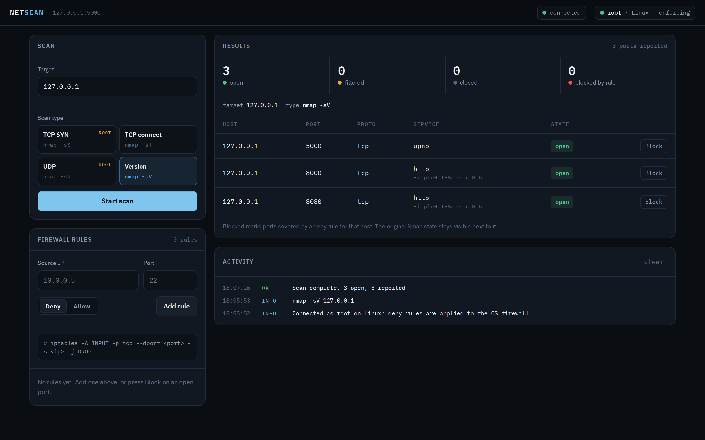
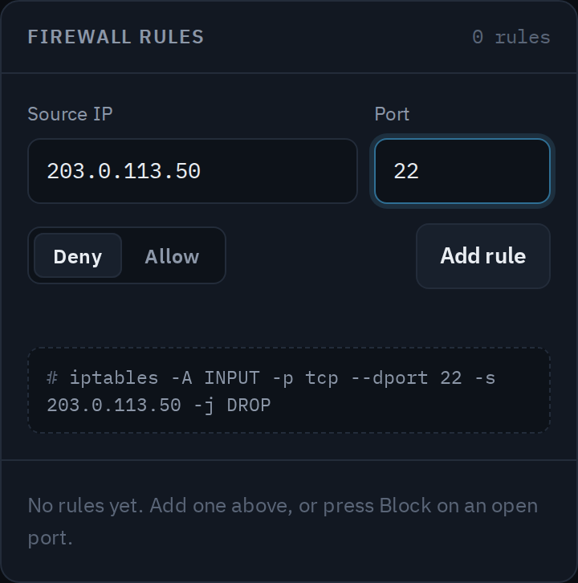
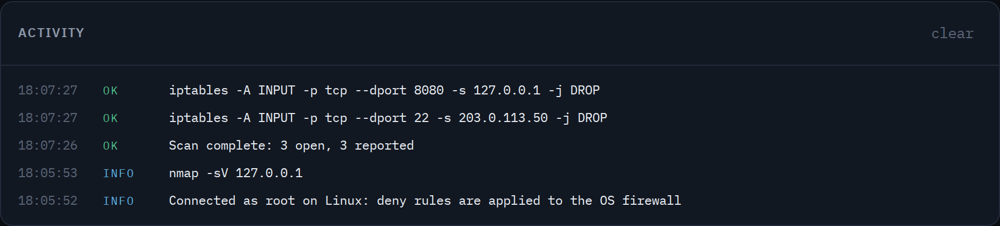
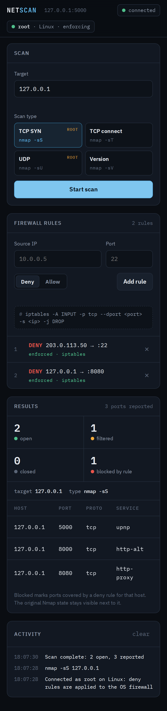

# Network Security Scanner with Firewall Rule Simulator

A real-time network security scanner and traffic control simulator built with **Python (Flask)**, **Flask-SocketIO**, and **Nmap**. Built to understand how network scanning and firewall logic actually work under the hood, the same core concepts used in tools like Nmap and pfSense, through a fully interactive, live web interface.

## Overview

This project provides an educational, hands-on sandbox for exploring network-level security concepts. Users can:

- Run live port scans in multiple modes (TCP SYN, UDP, service version detection)
- Create and manage firewall simulation rules (`allow` / `deny`) by IP and port
- Watch traffic get filtered in real time based on the rules applied
- See, visually and interactively, how firewall logic actually shapes what traffic gets through

I built this to go beyond just using scanning tools like Nmap and firewall interfaces like pfSense, and actually understand the mechanics behind them: how a scan differentiates open, closed, and filtered ports, and how firewall rule ordering and matching decide what traffic is allowed through.

**This isn't just a visual simulation.** When run with elevated privileges, adding a "deny" rule executes a real system-level firewall command, `netsh advfirewall` on Windows or `iptables` on Linux, actually blocking the specified IP and port at the OS level, not just in the UI. Removing the rule reverses it the same way.

---

## Installation

### Requirements

- Python 3.11
- `nmap` installed on your system
  - **Linux**: `sudo apt install nmap`
  - **macOS**: `brew install nmap`
  - **Windows**: [Download from nmap.org](https://nmap.org/download.html)
- Administrator (Windows) or root/sudo (Linux) privileges, required for the app to apply real firewall rules rather than just simulate them

### Setup

```bash
pip install -r requirements.txt
```

---

## Features

**Flexible Scanning**
- Scan an IP address, a CIDR range or a hostname
- TCP SYN scan, TCP connect scan, UDP scan and service version detection

**Simulated + Real Firewall Enforcement**
- Add allow or deny rules by IP and port
- When run with admin/root privileges, deny rules are applied as real `netsh` (Windows) or `iptables` (Linux) rules, actually blocking traffic at the OS level
- Without admin/root privileges, rules still work in the simulation and are labeled "simulated only"
- Remove rules dynamically, real and simulated
- Visualize rule impact on live scan results: ports keep their real Nmap state (open, closed, filtered) unless a deny rule marks them Blocked

**Operator Console UI**
- WebSocket-driven updates, no manual refresh needed
- Header shows the connection, the OS and whether the app is running with admin/root rights
- Color-coded port states with open / filtered / closed / blocked counts
- One-click **Block** and **Unblock** on each scanned port
- Preview of the exact `iptables` or `netsh` command before a rule is added
- Timestamped activity log of scans, rules and errors
- Rules are restored after a page reload, and the layout works on phones

---

## How to Use

```bash
python app.py
```

Run it with `sudo` (Linux) or from an Administrator terminal (Windows) to enforce rules at the OS level.

Then open `http://127.0.0.1:5000` in your browser:

1. Enter a target IP address, CIDR range or hostname
2. Pick a scan type and click **Start scan**
3. Press **Block** on an open port, or add a rule by source IP and port
4. Watch the port change to Blocked, and check the activity log for the command that ran
5. Press **Unblock** or the ✕ next to a rule to remove it

---

## Use Cases

- Networking and cybersecurity education
- Visual demonstration of firewall rule behavior
- Hands-on exploration of WebSockets and real-time interaction with Flask

---

## Project Outputs

**Full dashboard: a port blocked by a real iptables rule**


**Live scan in progress**


**Scan results with service version detection**


**Adding a firewall rule, with the exact command previewed**


**Activity log of scans and the firewall commands that ran**


**Phone layout.** With the deny rule active, Nmap now reports port 8080 as filtered, because the OS firewall drops the probe.


---

## Security

The first version built firewall commands from user input and ran them with `shell=True`, a command injection risk. I found it in a self-review and fixed it:

- IP addresses, ports, rule actions and scan targets are validated before use (Python's `ipaddress` module, port range 1-65535, allow/deny only)
- Firewall commands are passed as argument lists with no shell, so input can't be interpreted as extra commands
- On Linux, `sudo -n` fails cleanly instead of hanging on a password prompt
- The server binds to `127.0.0.1` with Flask's debugger turned off

---

## Known Limitations

- Real firewall rule application currently only supports Windows (`netsh`) and Linux (`iptables`); no macOS support yet.
- SYN and UDP scans require admin/root privileges (an Nmap requirement). TCP connect scans work without them.
- Rules applied to the OS firewall stay in place if the app is closed. Remove them in the app first, or delete them manually.
- Each scan runs in the request handler, so the UI waits for a long scan (for example UDP) to finish.

---

## License

Released under the [MIT License](LICENSE). Intended for educational and personal use. Feel free to modify and extend it.
